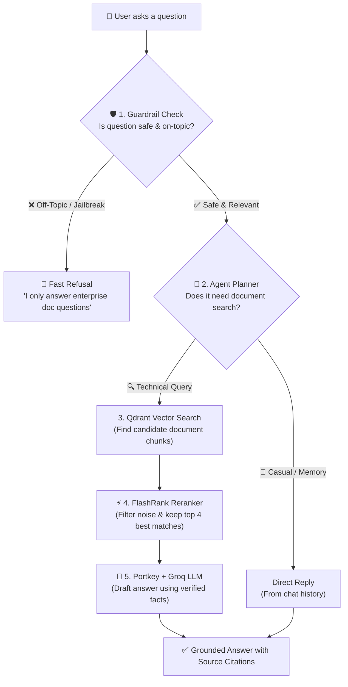
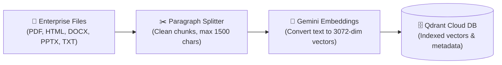
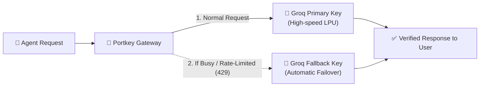

# 🛡️ AxiomRAG: Production-Grade Agentic Knowledge & Retrieval Platform

[](https://python.org)
[](https://fastapi.tiangolo.com)
[](https://streamlit.io)
[](https://langchain-ai.github.io/langgraph/)
[](https://portkey.ai)
[](https://qdrant.tech)
[](https://groq.com)
[](https://github.com/NVIDIA/NeMo-Guardrails)
[](https://logfire.pydantic.dev)
[](https://github.com/explodinggradients/ragas)

**AxiomRAG** is a battle-tested, enterprise-scale **Agentic Retrieval-Augmented Generation (RAG)** platform. Built with **LangGraph**, **NVIDIA NeMo Guardrails**, **Portkey LLM Gateway**, **Gemini Embeddings**, and **Qdrant Cloud**, this system is engineered to solve the most prevalent enterprise RAG bottlenecks: off-topic hallucinations, prompt injection vulnerability, noisy context dilution, and single-provider rate limit failures.

---

## 📑 Table of Contents

- [Architectural Overview](#-architectural-overview)
- [System Flowcharts](#-system-flowcharts)
  - [1. End-to-End Query Lifecycle](#1-end-to-end-query-lifecycle)
  - [2. Multi-Format Ingestion Pipeline](#2-multi-format-ingestion-pipeline)
  - [3. LLM Gateway & Resilient Fallback](#3-llm-gateway--resilient-fallback)
- [Core Features & Innovations](#-core-features--innovations)
- [How It Works: Step-by-Step Deep Dive](#-how-it-works-step-by-step-deep-dive)
- [Repository Structure](#-repository-structure)
- [Getting Started](#-getting-started)
  - [1. Clone and Create Virtual Environment](#1-clone-and-create-virtual-environment)
  - [2. Configure Environment Variables](#2-configure-environment-variables)
  - [3. Run Document Ingestion](#3-run-document-ingestion)
  - [4. Launch Backend & Frontend](#4-launch-backend--frontend)
  - [5. Run the Automated Evaluation Suite](#5-run-the-automated-evaluation-suite)
- [API Reference](#-api-reference)
- [Evaluation & Benchmark Methodology](#-evaluation--benchmark-methodology)
- [License](#-license)

---

## 🏛️ Architectural Overview

Unlike naive RAG pipelines that execute a rigid `Query ➔ Embed ➔ Top-K ➔ Answer` sequence, this system implements an **agentic state machine** with defensive boundaries:

1. **Defensive Perimeter (NeMo Guardrails)**: Intercepts all incoming queries. Off-topic queries (e.g., movies, cooking, small talk), prompt injection attempts, and jailbreaks are halted before executing vector search or spending LLM tokens.
2. **Agentic Router (LangGraph Planner)**: Classifies user queries into distinct intent pathways (`CONVERSATIONAL`, `TECHNICAL_RETRIEVAL`, or `OFF_TOPIC`) while analyzing multi-turn conversation memory.
3. **High-Dimensional Dense Retrieval (Gemini + Qdrant Cloud)**: Embeds document chunks using Google `gemini-embedding-2-preview` (3072-dimensional space) and executes cosine distance search.
4. **Zero-Latency Cross-Encoder Reranking (FlashRank)**: Re-scores the top vector candidates locally using lightweight transformers, filtering out distractor documents without adding external API latency.
5. **Gateway Resilience (Portkey)**: Dispatches LLM calls through Portkey with seamless automatic failover between primary Groq and backup Groq keys.
6. **Stateful Conversation Memory (LangGraph MemorySaver)**: Preserves conversational state, enabling natural contextual follow-up questions.
7. **End-to-End Observability**: Unified distributed tracing using **Pydantic Logfire** (for backend spans and Qdrant metrics) and **LangSmith** (for agent node execution).

---

## 📊 System Flowcharts

### 1. How a Query is Processed (User Query Lifecycle)



---

### 2. How Documents are Ingested (Data Ingestion Pipeline)



---

### 3. How the LLM Gateway Handles Failures (Zero-Downtime Fallback)



---

## ✨ Core Features & Innovations

| Component | Technical Implementation | Purpose & Advantage |
| :--- | :--- | :--- |
| **Agent Core** | LangGraph StateGraph | Enables non-linear cyclic workflows, conditional routing, and memory retention across multi-turn queries. |
| **Input Guardrails** | NVIDIA NeMo Guardrails + Colang | Zero-token rejection of off-topic topics, jailbreaks, and injection attacks before hitting vector DB or LLMs. |
| **Embeddings** | Google `gemini-embedding-2-preview` | 3,072-dimensional dense embeddings for high-fidelity semantic clustering and recall. |
| **Vector DB** | Qdrant Cloud | High-throughput similarity search utilizing Cosine distance metrics and rich metadata payloads. |
| **Reranking** | FlashRank Cross-Encoder | Local, high-speed neural reranking that weeds out false positives without incurring cloud API costs. |
| **LLM Gateway** | Portkey | Single unified interface with built-in fallbacks, request retries, rate-limit mitigation, and usage analytics. |
| **Observability** | Pydantic Logfire + LangSmith | Complete distributed tracing: nested spans for document parsing, embeddings, retrieval scores, and agent node transitions. |
| **Evaluation** | RAGAS Framework | Continuous automated assessment measuring Faithfulness, Answer Relevance, Context Precision, and Context Recall. |

---

## 🔍 How It Works: Step-by-Step Deep Dive

### Phase 1: Ingestion & Vector Indexing
1. Raw documents (`.pdf`, `.html`, `.docx`, `.pptx`, `.txt`) in `DATA/true_data` are scanned by `app/ingestion/processor.py`.
2. Extracted text is cleaned and divided into semantic paragraph blocks using `app/ingestion/chunking/splitter.py` with an upper bound of 1,500 characters.
3. Chunks are serialized into `processed_data/` for auditability.
4. Each chunk is passed to Google Gemini embeddings to generate 3072-dimensional vectors.
5. Vectors are upserted into Qdrant Cloud with metadata (`text`, `source`, `source_type`).

### Phase 2: Guardrail Intent Verification
1. User requests arrive at the FastAPI `/query` endpoint.
2. The query is evaluated by NeMo Guardrails (`app/guardrails/rails.py`) running Colang policies (`app/guardrails/colang_rules.py`).
3. If an off-topic topic (movies, sports, small talk, general knowledge) or adversarial prompt injection is detected, an explicit refusal is returned immediately.
4. Identity-preserving and conversational questions (e.g., *"What is my name?"*) are permitted to pass directly to the memory-aware agent.

### Phase 3: Agentic Routing (Planner Node)
1. The `PlannerNode` (`app/agents/nodes/planner.py`) inspects the query together with prior messages in `AgentState`.
2. The planner uses structured reasoning to pick an action path:
   - **`CONVERSATIONAL`**: Query can be answered directly using conversational memory (e.g. user introduced their name or asked a clarifying follow-up).
   - **`TECHNICAL_RETRIEVAL`**: Domain-specific query requiring fresh knowledge retrieval from Qdrant.
   - **`OFF_TOPIC`**: Edge-case off-topic query that bypassed the input guardrails.

### Phase 4: Dense Vector Search & Local Re-Ranking
1. In `RetrieverNode` (`app/agents/nodes/retriever.py`), the query is embedded via Gemini.
2. Qdrant returns the Top 10 candidate document chunks based on cosine similarity.
3. The candidates are passed to **FlashRank** (`app/services/retrieval/reranker.py`), a local cross-encoder model.
4. FlashRank re-scores chunk relevance against the user query, pruning distractor docs and keeping only the Top 4 most relevant excerpts.

### Phase 5: Answer Synthesis via Portkey Gateway
1. The `ResponderNode` (`app/agents/nodes/responder.py`) constructs a grounded prompt containing the re-ranked context.
2. The prompt is sent to the Portkey Gateway (`app/gateway/client.py`), which communicates with Groq LPUs.
3. If the primary model encounters rate-limiting or latency spikes, Portkey shifts the request to the fallback endpoint automatically.
4. The synthesized response cites the exact document sources used to answer the query.

### Phase 6: Memory Preservation
1. LangGraph's `MemorySaver` commits the turn's prompt, reasoning state, and answer under the active `thread_id`.
2. Future user questions in the same session can reference past statements seamlessly.

---

## 📂 Repository Structure

```text
├── app/
│   ├── agents/
│   │   ├── nodes/
│   │   │   ├── planner.py         # Intent classification & routing node
│   │   │   ├── retriever.py       # Qdrant search & FlashRank invocation
│   │   │   └── responder.py       # Grounded synthesis via Portkey gateway
│   │   └── state.py               # TypedDict defining AgentState
│   ├── gateway/
│   │   └── client.py              # Portkey client initialization & failover config
│   ├── guardrails/
│   │   ├── colang_rules.py        # Colang rules for off-topic & injection defense
│   │   └── rails.py               # NeMo Guardrails engine configuration
│   ├── ingestion/
│   │   ├── chunking/
│   │   │   └── splitter.py        # Paragraph-aware semantic text splitter
│   │   ├── loaders/
│   │   │   ├── pdf.py             # PDF extraction (pypdf + pdfplumber)
│   │   │   ├── html.py            # HTML extraction (BeautifulSoup)
│   │   │   ├── office.py          # Word (.docx) & PowerPoint (.pptx) parser
│   │   │   └── text.py            # Plain text loader
│   │   └── processor.py           # Universal batch ingestion engine
│   ├── services/
│   │   └── retrieval/
│   │       ├── embedding.py       # Google Gemini 3072-dim embeddings
│   │       ├── qdrant_service.py  # Qdrant Cloud client & vector query ops
│   │       └── reranker.py        # FlashRank local cross-encoder
│   ├── config.py                  # Dynamic configuration & environment parser
│   └── main.py                    # FastAPI application & /query endpoints
├── evals/
│   ├── golden_dataset.json        # Ground-truth evaluation dataset (15 samples)
│   ├── metrics.py                 # RAGAS metrics & Tool Correctness calculator
│   ├── pipeline.py                # Evaluation execution loop
│   └── app.py                     # Streamlit 3-tab evaluation dashboard
├── ui/
│   └── app.py                     # Streamlit chat interface with step inspection
├── DATA/
│   ├── true_data/                 # Authoritative Kubernetes operational knowledge
│   └── noisy_data/                # Distractor papers for retrieval stress-testing
├── DOCS/                          # Comprehensive architectural deep-dives
├── processed_data/                # Stored JSON chunks generated during ingestion
├── requirements.txt               # Pinned Python dependencies
└── .env.example                   # Environment configuration template
```

---

## 🚀 Getting Started

### 1. Clone and Create Virtual Environment

```bash
# Clone the repository
git clone https://github.com/viditsharma1405/AxiomRAG.git
cd AxiomRAG

# Create Python 3.11 virtual environment
python3 -m venv venv
source venv/bin/activate  # On Windows: venv\Scripts\activate

# Install dependencies
pip install -r requirements.txt
```

### 2. Configure Environment Variables

Copy the template to `.env`:

```bash
cp .env.example .env
```

Populate the `.env` file with your credentials:

```ini
# Reasoning Engine (Groq / Portkey)
GROQ_API_KEY="gsk_..."
GROQ_FALLBACK_API_KEY="gsk_..."
GROQ_MODEL="openai/gpt-oss-120b"
GROQ_FAST_MODEL="openai/gpt-oss-20b"

# Portkey LLM Gateway
PORTKEY_API_KEY="..."

# Qdrant Vector Database
QDRANT_API_KEY="..."
QDRANT_CLUSTER_ENDPOINT="https://your-cluster-url.cloud.qdrant.io:443"

# Google Gemini Embeddings
GEMINI_API_KEY="..."

# Observability (Logfire & LangSmith)
LOGFIRE_TOKEN="..."
LANGSMITH_TRACING=true
LANGSMITH_API_KEY="..."
LANGSMITH_PROJECT="enterprise_rag"

# Service Networking
BACKEND_URL="http://127.0.0.1:8000"

# Evaluation Judge LLM
JUDGE_GROQ="gsk_..."
```

### 3. Run Document Ingestion

Index the authoritative knowledge base into Qdrant Cloud:

```bash
# Ingest DATA/true_data and recreate the collection
python -m app.ingestion.processor DATA/true_data --wipe
```

### 4. Launch Backend & Frontend

Open two terminal sessions:

```bash
# Terminal 1: Launch FastAPI Backend
uvicorn app.main:app --port 8000 --reload
```

```bash
# Terminal 2: Launch Streamlit Chat Interface
streamlit run ui/app.py --server.port 8501
```

Access the chat interface in your browser at `http://localhost:8501`.

---

### 5. Run the Automated Evaluation Suite

Launch the interactive RAGAS evaluation dashboard:

```bash
streamlit run evals/app.py --server.port 8502
```

The eval app runs 15 curated test queries through the live backend, computing:
1. **Faithfulness**: Verifies whether the answer is mathematically grounded in the retrieved documents.
2. **Answer Relevance**: Measures semantic alignment between the query and generated answer.
3. **Context Precision**: Assesses whether relevant documents are ranked at the top.
4. **Context Recall**: Determines if all necessary ground-truth facts were retrieved.
5. **Tool Calling Correctness**: Computes Jaccard similarity between expected vs actual tool execution.

---

## 🔌 API Reference

### `POST /query`
Main endpoint for the conversational agent.

**Request Body:**
```json
{
  "query": "How do you start Redis for a Kubernetes work queue?",
  "thread_id": "session-12345"
}
```

**Response Body:**
```json
{
  "answer": "To start Redis for a Kubernetes work queue, run:\n\n1. kubectl apply -f https://k8s.io/examples/application/job/redis/redis-pod.yaml\n2. kubectl apply -f https://k8s.io/examples/application/job/redis/redis-service.yaml\n\nThis launches a single Redis pod and exposes it via a ClusterIP service.",
  "status": "success",
  "guardrail_status": "passed",
  "sources": ["parallel_work_queue.txt"],
  "route": "TECHNICAL_RETRIEVAL"
}
```

---

## 📈 Evaluation & Benchmark Methodology

The system is tested against `evals/golden_dataset.json`, which pairs real enterprise queries with expected context references and tool targets:

| Metric | Target Score | Evaluation Method |
| :--- | :---: | :--- |
| **Faithfulness** | `> 0.90` | LLM Judge verifies all claims exist in context |
| **Answer Relevance** | `> 0.85` | Embedding similarity between answer and user intent |
| **Context Precision** | `> 0.85` | Rank-weighted relevance of retrieved chunks |
| **Context Recall** | `> 0.90` | Coverage of ground-truth reference statements |
| **Guardrail Rejection** | `100%` | Zero off-topic queries allowed into vector search |

---

## 📜 License

This project is licensed under the [MIT License](LICENSE).
